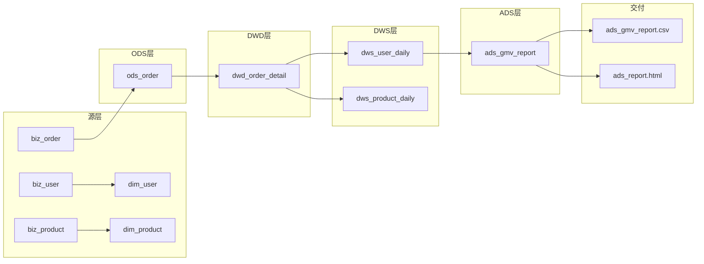

# Day64 · 数据治理：元数据与血缘（技术/业务元数据 + 血缘三用 + 数据字典）

> 模块五 · 大数据数仓进阶 Day9（加量版）| 配套脚本见 `scripts/day64/`（血缘图 + 数据字典）。
> 真实环境：MySQL information_schema 元数据采集 + mermaid 血缘图 + 数据字典文档。

---

## 1. 元数据（"描述数据的数据"）

| 类型 | 包含什么 | 谁关心 |
|------|----------|--------|
| 技术元数据 | 表名/字段/类型/分区/存储位置/ETL时间 | 开发 |
| 业务元数据 | 指标口径/字段业务含义/负责人/数据字典 | 业务+开发 |

> 面试一句话：技术元数据管"表长什么样、数据在哪"；业务元数据管"字段/指标什么意思、口径谁定的"。

## 2. 实操①：information_schema 采集技术元数据

```sql
-- 表级元数据
SELECT table_name, table_type, create_time
FROM information_schema.tables
WHERE table_schema = 'dw_project' ORDER BY table_name;
-- 结果：13 张表（含 spark_user_daily、dim_user_scd2 等新增表）

-- 字段级元数据
SELECT table_name, column_name, data_type, is_nullable, column_key
FROM information_schema.columns
WHERE table_schema = 'dw_project' ORDER BY table_name, ordinal_position;
-- 结果：63 个字段
```

> 这是"元数据采集"雏形：生产上扫进元数据平台（Atlas/DataHub），这里用 SQL 手工采集。**information_schema 查不到业务元数据（口径/含义）**——那部分靠数据字典。

## 3. 血缘（数据从哪来到哪去的依赖图）

### 三大用途（面试必答，Day51 深化）
```text
① 影响分析：改上游，哪些下游受影响（顺全部分支数，别漏）
② 溯源排查：报表错了，顺血缘找源头
③ 审计追溯：评估改表/删表/改口径的波及范围
```

### 实操②：mermaid 血缘图（代码化，可进 Git 版本化）


> 踩坑：影响分析漏了 dws_product_daily 分支（dwd 分叉成两条）——血缘价值实证：**漏一个下游就是事故**。

## 4. 数据字典（业务元数据载体，实操③）

```text
数据字典 = 每表/每字段的业务说明：字段含义、口径、枚举值、负责人
（information_schema 查不到的部分，靠数据字典补上）
```

核心口径（全仓统一）：GMV=已支付(status=2)金额合计；订单量=已支付笔数；客单价=GMV÷订单量；状态枚举 1未支付/2已支付/3已取消。

完整数据字典见 `scripts/day64/data_dictionary.md`。

---

## 今日面试考点清单
1. 技术 vs 业务元数据？→ 表结构存储 vs 口径含义负责人
2. information_schema 能查什么？→ 技术元数据；口径查不到
3. 血缘三用？→ 影响分析/溯源排查/审计追溯
4. 影响分析怎么数？→ 顺血缘所有下游分支，别漏
5. 数据字典管什么？→ 业务元数据；口径全仓统一防对不上

## 易混淆坑
- 元数据 ≠ 数据本身（是"关于数据的数据"）
- 影响分析要数全部分支（DWD 分叉两条 DWS）
- mermaid 用代码画图，可进 Git 版本化（vs 手画图不可维护）
- 数据字典补 information_schema 查不到的"口径/含义"
