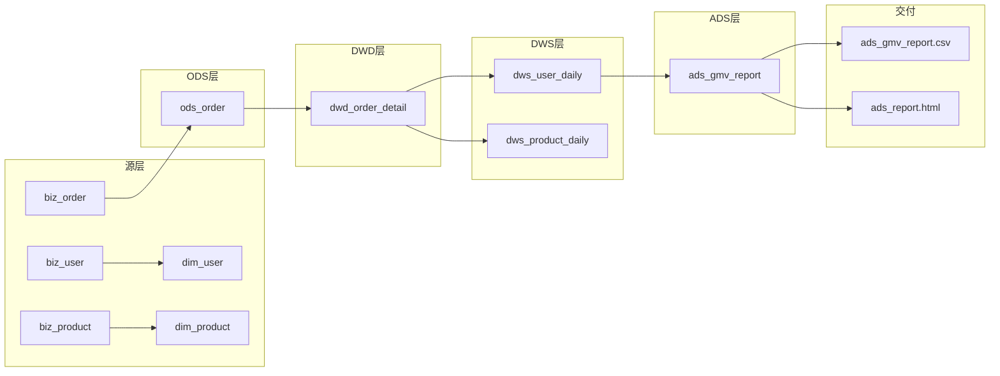

# 订单数仓 · 全链路血缘图（mermaid 代码化，可进 Git）

## 影响分析示例
- 改 ods_order 结构 → 影响 dwd_order_detail → dws_user_daily / dws_product_daily → ads_gmv_report → CSV/HTML
- ⚠️ 注意 DWD 分叉成两条 DWS，数下游分支别漏（dws_product_daily 是易漏分支）
